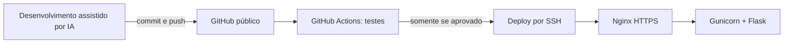

# Projeto Aplicado — aplicação web segura

Protótipo web com autenticação real no servidor, área interna protegida e logout. A entrega foi estruturada para demonstrar **Secure by Design**, **Secure by Default**, três ou mais categorias do **OWASP Top 10:2025**, infraestrutura Linux endurecida e implantação contínua pelo GitHub Actions.

> **Estado em 03/11/2026:** aplicação disponível em **https://163.176.111.141**, na OCI com Ubuntu 26.10. Critérios técnicos validados: login/logout, HTTPS confiável, renovação de ensaio, PQC e deploy automático do commit aprovado. SSL.org positivo e DigiCert PASS informado pelo aluno. CI com 21 testes aprovado e recuperação real comprovada. Consulte as [evidências reais](docs/EVIDENCIAS-ENTREGA.md), a [matriz de conformidade](docs/REVISAO-TECNICA.md) e o [roteiro OCI](deploy/oci/README.md).

## Visão geral



| Camada | Tecnologia | Responsabilidade |
|---|---|---|
| Aplicação | Python 3.12+ + Flask (3.14 na VM) | Login, sessão, autorização, CSRF e páginas |
| Processo | Gunicorn + systemd | Execução isolada e reinício automático |
| Borda | Nginx | HTTPS, redirecionamento, proxy e limitação de requisições |
| Servidor | Ubuntu/Debian | SSH, UFW, Fail2Ban e operação |
| Automação | GitHub Actions | Testes e deploy da versão aprovada |

Não existe banco de dados. O nome do usuário e o **hash** da senha são lidos de `/etc/projeto-aplicado.env`, fora do código e fora do Git.

As sessões usam cookie assinado e um ticket revogável em arquivos locais, compartilhados pelos workers. Em produção os tickets ficam em `/run/projeto-aplicado/sessions`, com acesso exclusivo ao usuário do serviço. Logout remove o ticket: copiar um cookie anterior não restaura o acesso. A expiração é absoluta; requisições não prorrogam os 30 minutos. Reiniciar o serviço invalida as sessões, pois o diretório é volátil. Não há serviço adicional nem armazenamento de senha nos tickets.

## Desenvolvimento assistido por inteligência artificial

O protótipo foi desenvolvido e auditado com assistência do Codex, ambiente de desenvolvimento baseado em inteligência artificial. A IA foi utilizada para estruturar o código, revisar controles de segurança, criar testes e preparar a automação; as decisões e os resultados foram validados por execução local, testes automatizados e auditoria das dependências. Isso atende ao uso de Antigravity ou ambiente similar previsto no escopo da disciplina.

## Funcionalidades obrigatórias

- Tela de login em `/login`.
- Página interna em `/dashboard`, protegida no servidor.
- Logout funcional via requisição `POST` protegida por CSRF.
- Endpoint local de saúde em `/healthz`.
- Interface responsiva para computador e celular.

## Execução local

### 1. Preparar o ambiente

É necessário Python 3.12 ou superior.

```bash
python3 -m venv .venv
source .venv/bin/activate
python -m pip install -r requirements-dev.txt
```

No Windows PowerShell, a ativação é:

```powershell
py -m venv .venv
.\.venv\Scripts\Activate.ps1
python -m pip install -r requirements-dev.txt
```

### 2. Gerar credenciais locais

O utilitário solicita a senha sem colocá-la no histórico do terminal:

```bash
python tools/generate_password_hash.py
```

Defina as variáveis abaixo. O valor de `APP_PASSWORD_HASH` é a saída do comando anterior; ele não é a senha em texto puro.

Linux:

```bash
export APP_ENV=development
export SECRET_KEY="$(openssl rand -hex 32)"
export APP_USERNAME="admin"
export APP_PASSWORD_HASH="cole-o-hash-aqui"
```

PowerShell:

```powershell
$env:APP_ENV = "development"
$env:SECRET_KEY = python -c "import secrets; print(secrets.token_hex(32))"
$env:APP_USERNAME = "admin"
$env:APP_PASSWORD_HASH = "cole-o-hash-aqui"
```

### 3. Executar

```bash
flask --app wsgi run
```

Acesse `http://127.0.0.1:5000`. Em desenvolvimento, o cookie seguro fica desativado para permitir HTTP local. Em produção, ele é obrigatório.

### 4. Testar

```bash
python -m pytest -q
```

Os testes verificam autenticação, autorização, revogação de cookie capturado após logout, compartilhamento entre instâncias da aplicação, expiração absoluta, rotação de cookie/CSRF, entradas inválidas, bloqueio por tentativas, escape HTML, limite do corpo, cabeçalhos e flags de cookie. `tests/test_release.py` exige Linux e testa ativação e recuperação usando serviços simulados; no Windows é explicitamente ignorado. Isso não substitui testar o deploy na OCI.

## OWASP Top 10:2025 — controles implementados

A relação abaixo usa os nomes da [lista oficial OWASP Top 10:2025](https://owasp.org/Top10/2025/).

### A01:2025 — Broken Access Control

**Risco:** acesso direto à área interna sem autenticação.

**Mitigação:** `app/security.py` fornece o decorador `login_required`; `app/auth.py` o aplica à rota `/dashboard` e ao logout. A decisão ocorre no servidor, e o usuário não consegue contorná-la alterando HTML ou JavaScript. O redirecionamento externo após login não é aceito.

**Comprovação:** `tests/test_auth.py::test_dashboard_requires_authentication` e `tests/test_auth.py::test_login_dashboard_and_logout`.

### A02:2025 — Security Misconfiguration

**Risco:** configurações padrão fracas, erros detalhados, cookies inseguros e serviços excessivamente expostos.

**Mitigação:** a aplicação falha ao iniciar sem segredo, usuário e hash; não há senha padrão. Cookies usam `HttpOnly`, `SameSite=Strict` e `Secure` em produção. CSP, `X-Content-Type-Options`, `X-Frame-Options`, HSTS, política de referenciador e política de permissões são enviados. Erros têm páginas genéricas. O Gunicorn escuta apenas em `127.0.0.1`, enquanto o UFW expõe somente 22, 80 e 443. O serviço systemd remove privilégios e limita o acesso ao sistema.

**Comprovação:** `tests/test_security.py`, `deploy/systemd/projeto-aplicado.service`, `deploy/nginx/projeto-aplicado.conf` e `deploy/provision.sh`.

### A05:2025 — Injection

**Risco:** entrada do usuário interpretada como HTML, comando ou consulta.

**Mitigação:** a aplicação não executa comandos nem monta consultas a partir de campos do login. O Jinja aplica escape automático à saída HTML. Usuário e senha têm limites de tamanho, o corpo total é limitado a 16 KiB e mensagens de log não registram o conteúdo fornecido. A Content Security Policy acrescenta uma barreira contra execução de conteúdo injetado.

**Comprovação:** validações em `app/auth.py`, limite em `app/__init__.py` e CSP em `app/security.py`.

### A07:2025 — Authentication Failures

**Risco:** força bruta, armazenamento inseguro da senha e sessão previsível ou duradoura.

**Mitigação:** apenas o hash `scrypt` é configurado; um valor em texto puro impede a inicialização. Há mensagem genérica, limitação de cinco falhas em quinze minutos por combinação de IP/usuário e limitação adicional no Nginx. O login renova cookie e CSRF e cria um ticket em `app/sessions.py`; logout revoga o ticket. A expiração absoluta padrão é de trinta minutos.

**Comprovação:** `tools/generate_password_hash.py`, `app/security.py` e `tests/test_auth.py::test_login_is_rate_limited_after_five_failures`.

### Controles complementares

- CSRF em todos os formulários que alteram estado.
- Comparação de token resistente a diferenças de tempo.
- Limite de 16 KiB por requisição.
- Logs de sucesso, falha, bloqueio, logout e erro interno sem senha.
- Identificador diferente para cada requisição.
- Dependências fixadas por versão e ações de CI fixadas por hash de commit.
- Deploy somente do commit testado e somente após evento `push` no repositório original.

> O limitador interno mantém dados na memória de cada processo. O Nginx fornece uma segunda limitação por IP, compartilhada na instância. Em uma aplicação distribuída, o estado do limitador deveria ser movido para Redis ou serviço equivalente.

## Preparação da nuvem

O provedor escolhido é a **Oracle Cloud Infrastructure**, com uma única VM A1 de produção (1 OCPU, 6 GB de RAM e disco de 50 GB), sem load balancer. DEV e HMG são branches com build/testes, sem VMs. O catálogo ARM ofereceu Ubuntu até 26.04 e o atualizador oficial não ofereceu 26.10. A VM vazia inicial foi substituída por uma imagem oficial Canonical Ubuntu 26.10, com SHA-256 conferido e boot UEFI/paravirtualizado. O sistema foi confirmado por SSH com chave de host comparada ao console OCI. A importação usou armazenamento temporário com orçamento autorizado de até US$ 0,10; imagem e bucket foram excluídos após o boot. Não se afirma custo total zero. Detalhes no [roteiro OCI](deploy/oci/README.md).

Regras a conferir na NSG/Security List e no UFW:

| Porta | Origem recomendada | Finalidade |
|---|---|---|
| 22/TCP | CIDR definido para administração e pipeline | SSH por chave e Fail2Ban |
| 80/TCP | internet | desafio ACME e redirecionamento |
| 443/TCP | internet | aplicação HTTPS |

Não autorize portas como 5000 ou 8000. O Gunicorn não deve ficar acessível pela internet.

**Compatibilidade com Actions:** restringir 22 apenas ao IP do aluno bloqueia os runners hospedados. Seus IPs são dinâmicos ([GitHub](https://docs.github.com/en/authentication/keeping-your-account-and-data-secure/about-githubs-ip-addresses)). O aluno autorizou explicitamente SSH público nesta VM com chave, senha/root desativados e Fail2Ban. A conexão de um runner real e o deploy foram aprovados. O roteiro explicita a decisão de origem; a pipeline não altera o firewall.

Antes do provisionamento:

1. Cadastre uma chave SSH no provedor e confirme que ela aparece em `~/.ssh/authorized_keys` na VM.
2. Acesse a VM usando a chave, nunca enviando a chave privada ao servidor.
3. Clone este repositório na VM.
4. Confirme que o sistema oferece OpenSSL 3.5+ e o grupo híbrido `X25519MLKEM768`. O script interrompe a configuração se o suporte PQC não estiver disponível.

Execute a partir da raiz do repositório clonado:

```bash
sudo bash deploy/provision.sh IP_PUBLICO SEU_EMAIL /caminho/deploy.pub CIDR_SSH
```

O script:

- verifica a existência de uma chave SSH antes de desabilitar senhas;
- instala Nginx, Python, Fail2Ban, UFW e Certbot 5.8;
- cria usuário de serviço sem login e usuário `deployer` dedicado, com chave própria e sem sudo geral;
- solicita usuário e senha inicial da aplicação;
- cria o arquivo de segredos com permissão restrita;
- configura Gunicorn/systemd e Nginx;
- habilita o grupo híbrido PQC `X25519MLKEM768`;
- emite o certificado, ativa renovação e recarregamento automático;
- limita o firewall às três portas documentadas;
- configura o Fail2Ban para quatro erros e banimento por 24 horas;
- instala o arquivo SSH `00-projeto-aplicado.conf` antes do cloud-init e confere o resultado efetivo com `sshd -T`;
- executa verificações locais ao final.

Se não quiser cadastrar um e-mail no ACME, o segundo argumento pode ser `-`; nesse caso o registro usa a opção oficial de conta sem e-mail. Nenhuma informação da conta OCI é encaminhada como contato automaticamente.

**Cuidado:** mantenha a sessão SSH atual aberta. Antes de fechá-la, abra uma segunda sessão e confirme que o acesso por chave continua funcionando.

## HTTPS por IP e renovação

Para IPs, o script fixa Certbot 5.8 em modo `webroot`, `--ip-address` e `--required-profile shortlived`, sem fallback silencioso de perfil ([Certbot](https://eff-certbot.readthedocs.io/en/stable/man/certbot.html)). O timer verifica a renovação duas vezes por dia e o hook valida/recarrega o Nginx. Na VM, a emissão por IP e a renovação de ensaio foram aprovadas; datas e resultados externos estão nas [evidências](docs/EVIDENCIAS-ENTREGA.md).

O Certbot armazena o certificado em:

```text
/etc/letsencrypt/live/IP_PUBLICO/fullchain.pem
/etc/letsencrypt/live/IP_PUBLICO/privkey.pem
```

O redirecionamento HTTP → HTTPS está em `deploy/nginx/projeto-aplicado.conf`. Para testar a renovação:

```bash
sudo certbot renew --dry-run
systemctl list-timers certbot-renew.timer
```

Se for utilizado um domínio, o mesmo script detecta o nome e solicita um certificado ECDSA. A assinatura ECDSA do certificado é distinta da troca de chaves híbrida TLS `X25519MLKEM768`. Nem a presença da diretiva PQC nem um handshake local substituem os verificadores externos exigidos no escopo.

## CI/CD com GitHub Actions

O repositório usa três branches permanentes e promoção por Pull Request:

| Branch | Ambiente lógico | Resultado automático |
|---|---|---|
| `dev` | DEV | build + testes, sem publicação |
| `hmg` | HMG | build + testes, sem publicação |
| `main` | Produção | build + testes; deploy somente se explicitamente habilitado |

O fluxo possui duas etapas:

1. `.github/workflows/ci.yml` instala as versões fixadas, valida o build e executa os testes em cada `push` ou Pull Request para `dev`, `hmg` e `main`.
2. `.github/workflows/deploy.yml` roda somente após um CI aprovado originado por `push` na `main` do próprio repositório e quando a variável **de repositório** `PRODUCTION_DEPLOY_ENABLED=true`. Envia um `git archive` do commit testado, contendo apenas os caminhos necessários. `deploy/release.sh` instala em diretório novo, troca `current` atomicamente e espera o serviço responder; falhas após ativação restauram a versão anterior. Uma falha continua deixando a pipeline vermelha, mesmo quando a recuperação funciona.

O CI de DEV/HMG não referencia environments ou segredos de produção e não possui nenhuma etapa de publicação. O fluxo esperado é `feature/*` → `dev` → `hmg` → `main`; correções urgentes usam `hotfix/*` a partir da `main` e depois retornam para `hmg` e `dev`.

As branches `dev`, `hmg` e `main` estão protegidas contra push direto e *force push*, inclusive para o administrador. As promoções exigem Pull Request, resolução das conversas e aprovação do status check **Build e testes** sobre a base atual. Como há um mantenedor, não foi exigida aprovação por um segundo revisor.

Quando os históricos divergem, criar uma branch de promoção a partir da origem e incorporar a base de destino antes de abrir o PR. Isso permite promover `dev` → `hmg` → `main` com checks estritos sem push direto nas branches permanentes. Correções a partir da `main` retornam pelo mesmo fluxo; o histórico pode conter commits de merge diferentes mesmo com conteúdo idêntico.

O *environment* `production` foi configurado e os quatro Secrets foram cadastrados com autorização. Para reproduzir a configuração, use:

| Tipo | Nome | Conteúdo |
|---|---|---|
| Secret | `SERVER_HOST` | IP público ou domínio, sem `https://` |
| Secret | `SERVER_USER` | `deployer`, usuário dedicado criado pelo provisionamento |
| Secret | `SERVER_SSH_KEY` | chave privada dedicada ao deploy |
| Secret | `SERVER_KNOWN_HOSTS` | linha verificada da chave pública do servidor SSH |
| Variable | `SERVER_PORT` | `22` (opcional; 22 é o padrão) |
| Variable de repositório | `PRODUCTION_DEPLOY_ENABLED` | `true` após validar a VM; ausente ou `false` desativa o deploy |

Obtenha a chave de host por um canal confiável, como o console do provedor. Não aceite cegamente a saída de `ssh-keyscan`: compare a impressão digital apresentada com `/etc/ssh/ssh_host_ed25519_key.pub` na VM.

O script usa o administrador da nuvem somente no provisionamento. O `deployer` recebe apenas reinício e consulta do serviço via sudo; a chave usa a opção SSH `restrict`. Não reutilize a chave pessoal nem a chave do trabalho. A restrição precisa ser confirmada com `sudo -l -U deployer` na VM.

Versões anteriores ficam conservadas para recuperação. Para restauração manual, pause publicações, identifique um diretório em `/opt/projeto-aplicado/releases`, crie um link temporário e substitua `current` com `mv -Tf`; reinicie o serviço e verifique `/healthz`. Antes de remover versões antigas, confira `readlink -f /opt/projeto-aplicado/current`; nunca apague a atual nem a última versão saudável. O roteiro OCI contém os comandos.

## Operação e diagnóstico

```bash
# Estado dos serviços
sudo systemctl status projeto-aplicado nginx fail2ban

# Logs da aplicação
sudo journalctl -u projeto-aplicado --since today

# Estado do bloqueio do SSH
sudo fail2ban-client status sshd

# Verificações automatizadas locais
sudo bash deploy/verify-security.sh IP_PUBLICO
```

Para trocar as credenciais, gere outro hash, edite `/etc/projeto-aplicado.env` como root e reinicie somente o serviço:

```bash
sudo systemctl restart projeto-aplicado
```

## Evidências para a apresentação

Para a entrega em vídeo, siga o [roteiro em português com falas, abas e tempos](docs/ROTEIRO-GRAVACAO.md) e a [cola de gravação](docs/COLA-GRAVACAO.md). A apresentação foi planejada para cerca de oito minutos, dentro dos cinco a dez minutos indicados pelo professor. Uma única página interna é suficiente; o painel mostra dados do acesso, sem métricas de monitoramento simuladas. `deploy/presentation.sh` prepara consultas de infraestrutura, TLS e versão ativa sem ler credenciais.

Salve capturas sem expor chaves, hashes completos ou outros segredos:

- aplicação acessível pelo IP/domínio em HTTPS;
- login inválido com mensagem genérica;
- dashboard depois do login e redirecionamento ao tentar acessá-lo sem sessão;
- logout retornando para o login;
- repositório público e execução verde do GitHub Actions;
- deploy automático concluído;
- `ufw status verbose` mostrando apenas 22, 80 e 443;
- `fail2ban-client status sshd` e arquivo com `maxretry = 4`, `bantime = 24h`;
- configuração SSH com `PasswordAuthentication no`;
- timer de renovação ativo e `certbot renew --dry-run` aprovado;
- resultado do SSL Certificate Checker exigido para IP ou nota A no SSL Labs para domínio;
- para acesso por IP, resultado do DigiCert TLS Quantum Readiness exibindo suporte a PQC; para domínio, indicação PQC no SSL Labs;
- testes locais aprovados.

## Correspondência com o escopo

A tabela abaixo mapeia arquivos, não comprova produção. A situação de cada critério e sua forma de validação estão na [matriz de conformidade](docs/REVISAO-TECNICA.md).

| Exigência | Implementação |
|---|---|
| Login, página interna e logout | `app/auth.py` e templates |
| Três vulnerabilidades OWASP | A01, A02, A05 e A07 documentadas acima |
| Nginx/Apache | Nginx em `deploy/nginx/` |
| Ubuntu/Debian | provisionamento por APT |
| SSH por chave | validação e `deploy/ssh/00-projeto-aplicado.conf` |
| Fail2Ban 4 erros/24 h | `deploy/fail2ban/sshd.local` |
| Somente portas necessárias por rede | UFW e Security Group documentados |
| HTTPS e redirecionamento | Certbot + Nginx |
| Renovação automática | timer e *deploy hook* em `deploy/certbot/` |
| PQC | `X25519MLKEM768` obrigatório no provisionamento |
| `.gitignore` sem segredos | `.gitignore` e `.env.example` seguro |
| GitHub Actions | CI e deploy em `.github/workflows/` |
| README técnico | este documento |

## Situação da entrega e limites de validação

A conta OCI foi acessada por sessão temporária e a infraestrutura anterior foi removida com autorização. A nova aplicação foi validada externamente, inclusive revogação de sessão e negociação híbrida `X25519MLKEM768`. As branches estão protegidas e as promoções usam PR e CI; somente `main` publica. O deploy automático concluiu com SHA conferido na VM e o ensaio de falha restaurou a versão saudável. A matriz registra a situação de cada critério. O armazenamento temporário da imagem foi autorizado até US$ 0,10 e removido; a contabilização final depende da Oracle. O aluno pode acrescentar capturas à apresentação usando o roteiro de evidências.
